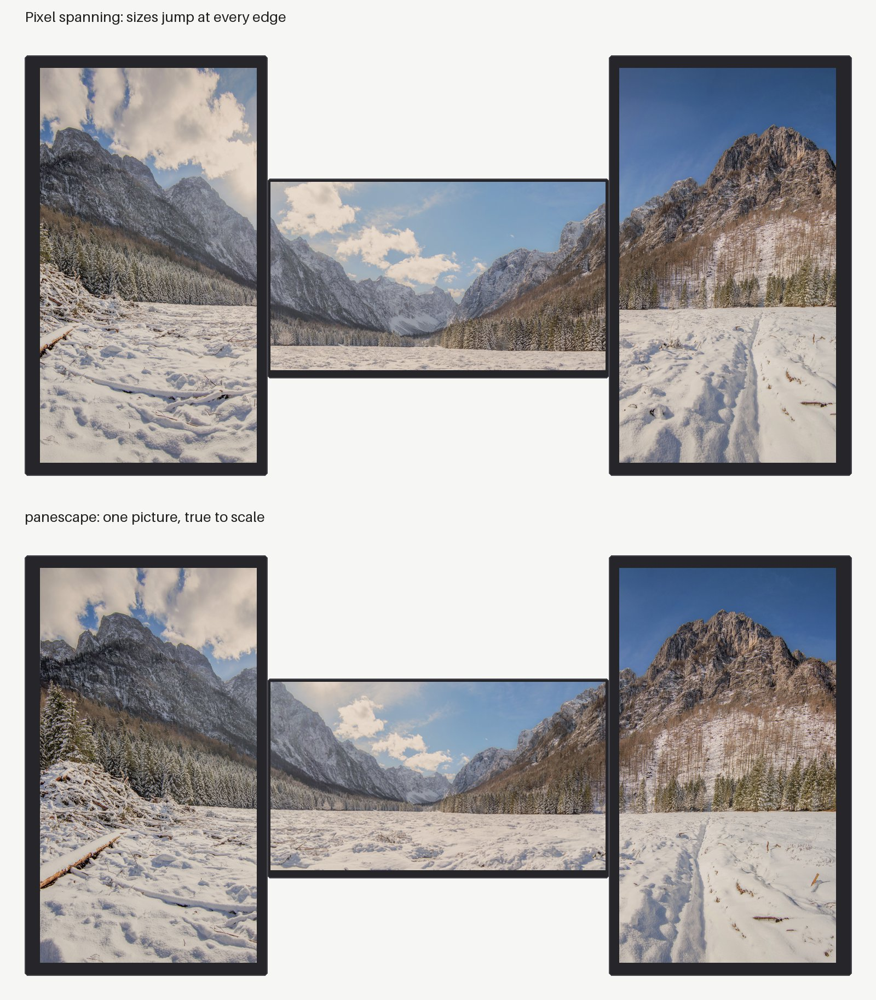
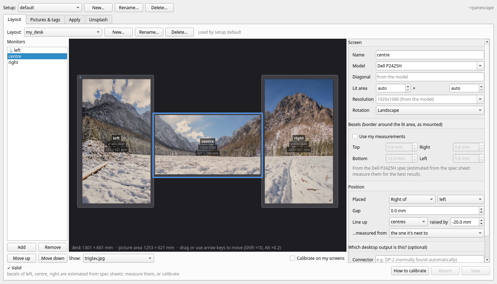
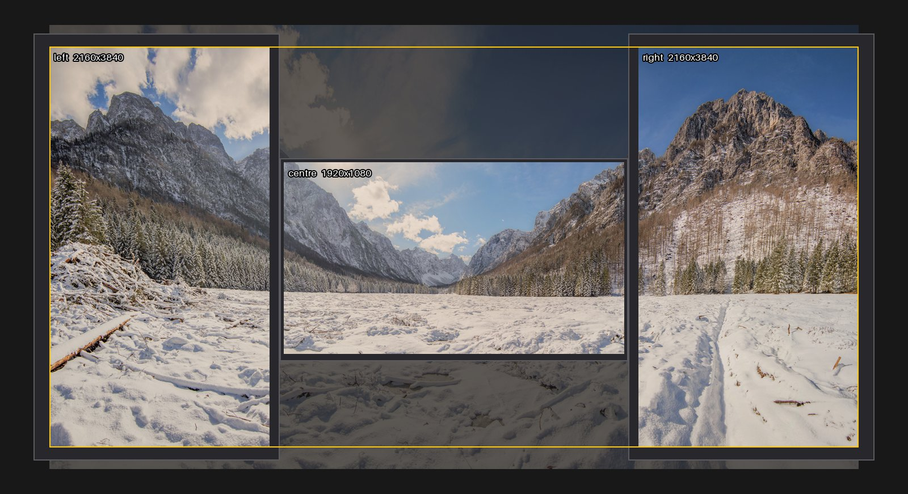

# panescape

[](https://github.com/keo99/panescape/actions/workflows/ci.yml)
[](https://pypi.org/project/panescape/)

**True-to-scale wallpapers for multi-monitor setups on Linux.** Your monitors
become panes of one window onto a single picture, even when they differ in size,
resolution, orientation and height.



Most spanning tools work in **pixels**. A 28" 4K panel packs about 1.7× more
pixels per millimetre than a 24" 1080p panel, so with pixel spanning the picture
changes size at every screen edge and the horizon breaks. panescape works in
**millimetres**. It uses each panel's real lit area, the bezels, the gaps and the
vertical offsets you measure. Then it resamples each monitor's slice to that
monitor's native resolution.

**Documentation: [keo99.github.io/panescape](https://keo99.github.io/panescape/)**

## Install

```bash
pipx install 'panescape[gui]'    # or without [gui] for the command line only
panescape-gui
```

Linux with Python 3.10 or newer. Wallpapers and slideshows are applied on
**GNOME**, **KDE Plasma 6**, **sway** and **Hyprland**; on other desktops
panescape makes per-monitor images for your own tool
([Desktops](https://keo99.github.io/panescape/desktops/)).

## The Window

[](https://keo99.github.io/panescape/window/)

Describe your desk to scale, calibrate it on your real screens, tag and frame
your pictures, find new ones on Unsplash, and apply one picture or a
slideshow that changes every screen at once. A *Getting started* guide walks
you through it the first time. See [The Window](https://keo99.github.io/panescape/window/).

## Quick Start on the Command Line

```bash
mkdir ~/panescape && cd ~/panescape
panescape init                     # pictures/, configurations/, backgrounds/, setup.yml
panescape detect --write my_desk   # a layout from your current displays
$EDITOR configurations/my_desk.yml # set gaps, offsets, bezels (mm)
panescape calibrate --watch        # test pattern; re-applies on every save
cp ~/Pictures/some-wide-photo.jpg pictures/
panescape make                     # check backgrounds/my_desk/*/preview.jpg
panescape apply
```

`preview.jpg` draws your desk to scale. The yellow outline is the part of the photo that was used:



More: [Getting Started](https://keo99.github.io/panescape/getting-started/), [Configuration](https://keo99.github.io/panescape/configuration/),
[Command Line](https://keo99.github.io/panescape/cli/).

## Contributing

Bug reports and pull requests are welcome, especially new monitor models and
backends for more desktops. See [Development](https://keo99.github.io/panescape/development/).

## Credits

Images use "Panorama of the valley of the Triglav mountain massif" by
otrow_photography, released under
[CC0 1.0](https://creativecommons.org/publicdomain/zero/1.0/) via
[Wikimedia Commons](https://commons.wikimedia.org/wiki/File:Panorama_of_the_valley_of_the_Triglav_mountain_massif.jpg).
The Unsplash tab is for personal use with your own key; panescape is not
affiliated with or endorsed by Unsplash.

## License

MIT © Kieran Ralston
