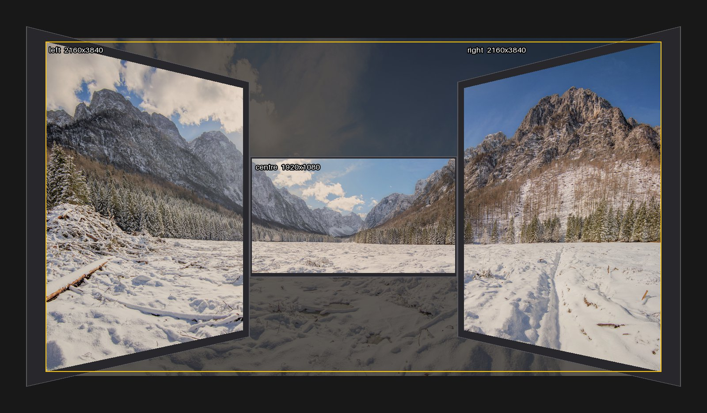

# Angled and Tilted Screens

By default panescape treats your desk as flat. That's right when the screens
stand in a line. It's close enough when the outer ones are turned in a little,
because the picture still joins up along the screens, like a folding screen.

Turn them in further, or tilt a laptop screen back, and seen from your chair the
lines only meet at eye level. Above and below it, they drift apart more and more
the further they are from your eyes. That's because the near side of an angled
screen is closer to you, so everything on it looks bigger.

Angled screens is an **opt-in** correction for this. panescape works out where
each screen is in 3D and where your eyes are. Then it pre-distorts the picture on
the angled screens, so that **from your seat** the desk looks like one flat
window onto the picture, at every height.

[](images/angled.jpg)

!!! note "One seat"
    The picture is made to look right from one place. Move your head and it's a
    little off; sit somewhere else and it's more off. Flat screens are never
    affected. They show exactly what they would without the correction.

## Switching It On

In the window, open the Layout tab and tick **My screens are angled or tilted**,
at the bottom of the form on the right. Then give each angled monitor its
**Turned towards you** and **Leaning back** values, under its position.

In the YAML, add a `viewer` section. Without it, `angle` and `tilt` are ignored:

```yaml
viewer:
  distance: 650     # mm from your eyes straight to the first monitor's screen
  height: 0         # mm your eyes are above (+) or below (-) its centre
  offset: 0         # mm your eyes are right (+) or left (-) of its centre
monitors:
  - name: centre    # the first monitor: the others' angles are measured from it
    model: Dell P2425H
  - name: right
    right_of: centre
    angle: 30       # degrees turned towards you (0 = flat with the first monitor)
    tilt: 0         # degrees leaning back from upright (top further away)
```

`viewer: {}` uses the defaults: 600 mm away, level with the centre of the first
monitor. See the full [angled-wings example](https://github.com/keo99/panescape/blob/main/examples/configurations/angled-wings.yml).

| key | meaning |
|---|---|
| `viewer.distance` | From your eyes straight to the first monitor's screen, in mm |
| `viewer.height` | Your eyes above (+) or below (−) the first monitor's centre |
| `viewer.offset` | Your eyes right (+) or left (−) of the first monitor's centre |
| `angle` | Degrees the monitor is turned to face you, compared with the first monitor. Works the same for screens on your left and right. The first monitor has none: it's the reference |
| `tilt` | Degrees the monitor leans back from upright, top further away. Negative leans forward. A tilt on the first monitor too only counts as the difference between them |

**Put the screen you face first.** Angles are measured from the first monitor,
so a centre screen you look straight at makes the best first monitor.

## How the Screens Fit Together

Each monitor hangs off the one it's placed next to (`right_of`, `below`, …), hinged
on the edge they share, and turns from there. `gap`, `v_pos` and the bezels mean
what they always do, measured along the screens as if the desk were folded flat.
So measure them the usual way, then add the angles.

## Measuring Angles

You rarely need a protractor:

- **Turned towards you:** measure how much closer to you the screen's far edge is
  than its near edge. Measure straight towards you, from the front edge of the desk,
  for example. In the window, press **From mm…** next to the angle and type that
  in. The angle is `asin(closer ÷ housing width)`.
- **Leaning back:** measure how much further back the top edge is than the bottom
  edge, and use **From mm…** next to the tilt. A phone's level app also works.
- **Your eyes:** sit as you normally do and measure from your eyes to the first
  monitor's screen. Most people's eyes are level with the upper half of the
  screen; measure that too if you can.

Then fine-tune by eye (below).

## Calibrating from Your Seat

Tick **Calibrate on my screens** on the Layout tab, sit where you normally sit, and
**close one eye**. The correction is exact for one eye; with both open it's a
compromise. On the angled screens the pattern looks bent on purpose: from your
seat it should run straight on.

1. **Gaps and heights first,** as on a flat desk ([Calibrating](calibrating.md)).
   Use the lines at eye level: they line up whatever the angles are.
2. **Angle.** Look at the horizontal lines near the top and bottom. If they bend
   away from eye level on an angled screen, its angle is too small; if they bend
   towards it, too large.
3. **Eye height.** The line that crosses straight at every angle should be the one
   level with your eyes. If it's higher or lower, change **Eyes raised by**.
4. **Distance.** If the 45° lines change slope where they cross onto an angled
   screen, change **Eyes to first screen**.

The rulers are left off angled screens, since they only make sense on a flat desk.
