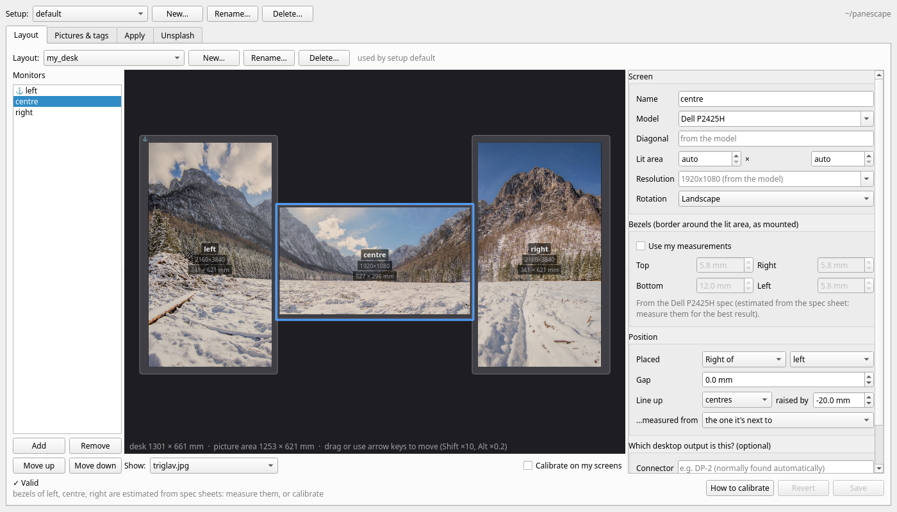
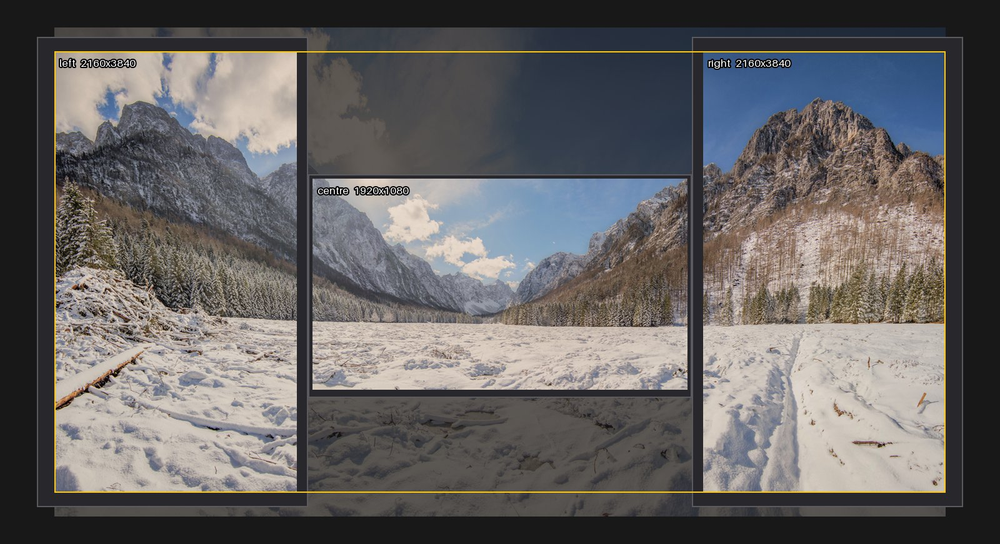

# Getting started

Everything panescape knows lives in one **project folder**, `~/panescape` for
example: your pictures, a layout for each desk you use, and `setup.yml`, which
says what to put on the desktop. See [The project folder](cli.md#the-project-folder).

## In the window

Run `panescape-gui`. The first time, it asks for a folder and sets it up. A
**Getting started** strip at the top then walks you through three steps.

1. **Describe your monitors.** Press **New…** on the Layout tab and start from
   the monitors connected now. panescape fills in what it knows about each
   model. Then measure the gaps between your screens and how high each one
   sits, and enter them, or drag the monitors on the desk.
   Tick **Calibrate on my screens** to fine-tune with a test pattern
   ([Calibrating](calibrating.md)).
2. **Add pictures.** Drop pictures onto the Pictures & tags tab, press **Add
   pictures…**, or find some on the [Unsplash](unsplash.md) tab. Wide
   landscape photos suit a row of monitors best. Tag them if you'd like to
   choose by tag later.
3. **Apply to the desktop.** On the Apply tab, choose one picture or a
   slideshow, how long each picture stays and which pictures to use, then
   press **Apply to the desktop**.



More on each tab: [The window](window.md).

## On the command line

```bash
mkdir ~/panescape && cd ~/panescape
panescape init                     # pictures/, configurations/, backgrounds/, setup.yml
panescape detect --write my_desk   # a layout from your current displays
$EDITOR configurations/my_desk.yml # set gaps, offsets, bezels (mm)
panescape calibrate --watch        # test pattern; re-applies on every save
cp ~/Pictures/some-wide-photo.jpg pictures/
panescape make                     # check backgrounds/my_desk/*/preview.jpg
panescape apply
```

`preview.jpg` draws your desk to scale. The yellow outline is the part of the
photo that was used:



Next: [Configuration](configuration.md) for every layout setting, and
[Setups and slideshows](setups.md) for what `apply` puts on the desktop.

## Getting the most out of it

- **Measure, don't guess.** Use the monitor's `model` (or its exact lit area)
  and measure the bezels with a ruler; see the
  [precision tips](configuration.md#precision-tips).
- **Use big pictures.** For a sharp result, a picture should be at least as
  many pixels wide as your desk needs. panescape warns when a screen would
  show it enlarged.
