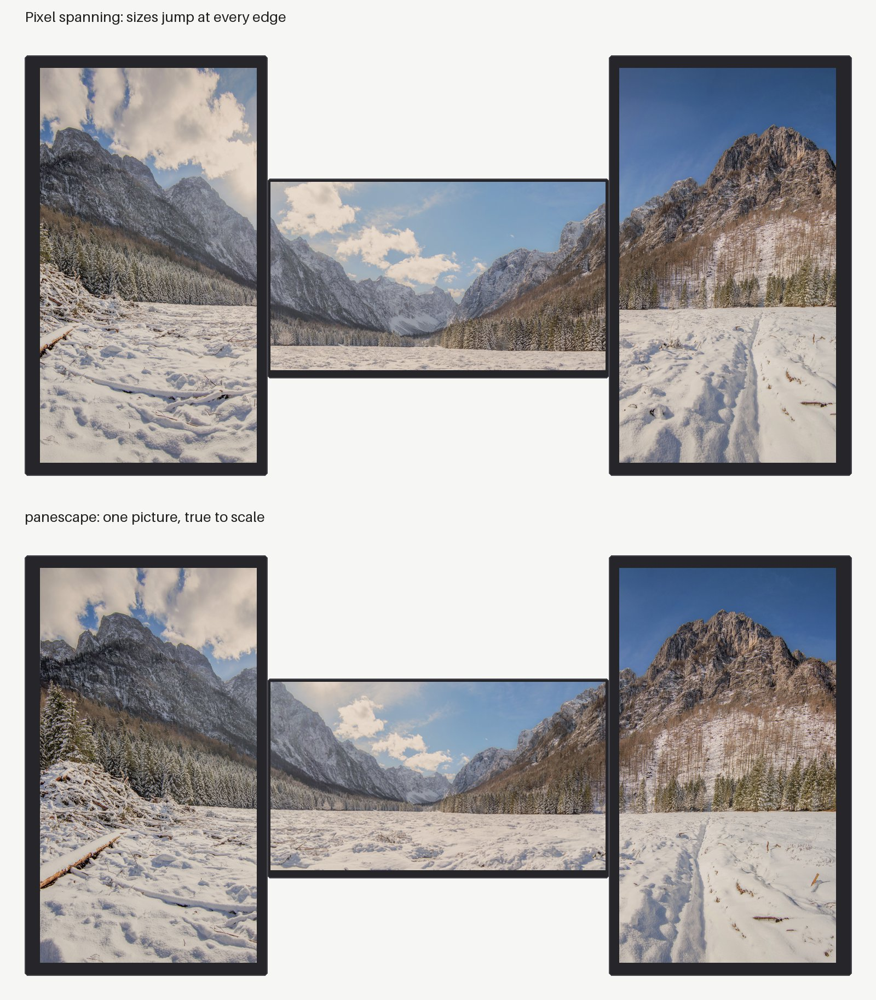

# panescape

**True-to-scale wallpapers for multi-monitor setups on Linux.** Your monitors
become panes of one window onto a single picture, even when they differ in size,
resolution, orientation and height.



Most spanning tools work in **pixels**. A 28" 4K panel packs about 1.7× more
pixels per millimetre than a 24" 1080p panel, so with pixel spanning the picture
changes size at every screen edge and the horizon breaks. panescape works in
**millimetres**. It uses each panel's real lit area, the bezels, the gaps and the
vertical offsets you measure. Then it resamples each monitor's slice to that
monitor's native resolution.

```bash
pipx install 'panescape[gui]'
panescape-gui
```

Then follow [Getting started](getting-started.md).

## What it does

- **Measures in millimetres:** a layout describes your real desk: each screen's
  model or size, its bezels, the gaps between screens and how high each one sits.
  See [Configuration](configuration.md) and [Layouts](layouts.md).
- **Calibrates on your screens:** a millimetre test pattern shows where the
  lines break across bezels, so you can tune the layout until they don't
  ([Calibrating](calibrating.md)).
- **Slideshows that stay in step:** every screen changes at the same moment,
  chosen by tags and filters such as `landscape + water + !night`
  ([Setups and slideshows](setups.md), [Pictures](pictures.md)).
- **A window and a command line** that edit the same files, keeping your
  comments ([The window](window.md), [Command line](cli.md)).
- **Unsplash search** with suggestions based on your tags, and credits kept
  for every photo ([Unsplash](unsplash.md)).

## Supported desktops

| desktop | how panescape applies the wallpaper | tested with |
|---|---|---|
| GNOME | one spanned image; slideshows run by GNOME itself | GNOME 50 (Ubuntu 26.04), Wayland, fractional scaling |
| KDE Plasma 6 | a native slice per screen | Plasma 6.6 |
| sway | a native slice per output | sway 1.11 |
| Hyprland | a native slice per output | Hyprland 0.53 with hyprpaper 0.8 |
| anything else | per-monitor images for your own tool | |

Details for each are on the [Desktops](desktops.md) page.

## Why not HydraPaper or a "spanned" wallpaper?

Those work too. You give them one image per monitor, or one image stretched over
the desktop, and they place it in pixel space. panescape decides *what each
monitor should show* from the physical layout, and builds the images those
tools need. On GNOME it applies them directly, slideshows included, with
nothing running in the background.

If you used HydraPaper before, switch off its daemon in HydraPaper's
preferences. Otherwise it re-applies its own wallpaper whenever the displays
change, for example when the monitors wake up. panescape warns when it sees
HydraPaper's daemon or Variety running.

## Credits

The pictures on this site use "Panorama of the valley of the Triglav mountain
massif" by otrow_photography, released under
[CC0 1.0](https://creativecommons.org/publicdomain/zero/1.0/) via
[Wikimedia Commons](https://commons.wikimedia.org/wiki/File:Panorama_of_the_valley_of_the_Triglav_mountain_massif.jpg).
panescape is MIT licensed.
