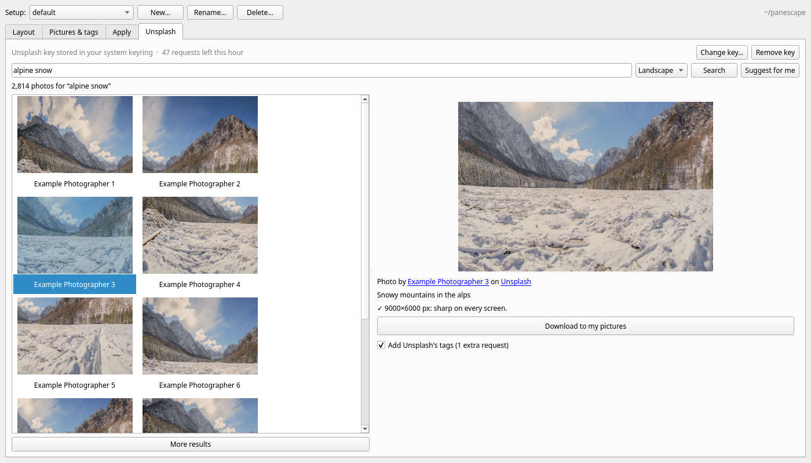

# Unsplash

The **Unsplash** tab finds new pictures for your desk.

The screenshot shows made-up sample results.

## Finding and downloading photos

- **Search** Unsplash (landscape photos by default, since they suit a wide
  desk), or press **Suggest for me** for photos like the ones you have, based
  on your most used tags. Photos you already have are left out of the
  suggestions.
- **Choose a photo** to see it larger, with its photographer and a note on
  whether it's sharp enough for your desk.
- **Download to my pictures** saves it into `pictures/` (named like
  `ann-lee-Zx3abcDEF12-unsplash.jpg`). The photo's Unsplash tags are added,
  minus generic ones like "hd wallpapers", and the credit goes in
  `pictures/credits.yml`. The Pictures tab then shows "Photo by … on Unsplash".

## Your Unsplash access key

Searching needs a free key of your own:

1. Sign in at [unsplash.com/oauth/applications](https://unsplash.com/oauth/applications)
   and create a **New Application** (any name, e.g. *my panescape*).
2. Copy its **Access Key** (not the Secret key) and paste it into the tab.

## Requests and the hourly limit

A new key allows 50 requests an hour. The tab shows how many are left.

| action | requests |
|---|---|
| a search, or a page of more results | 1 (cached for an hour, so repeating it is free) |
| **Suggest for me** | 1 per tag it searches (up to 3) |
| showing thumbnails and previews | 0 |
| downloading the picture file | 0 |
| the download report Unsplash requires | 1 per download |
| **Add Unsplash's tags** (ticked) | 1 more per download |

Search results don't include Unsplash's tags, which is why getting them costs
an extra request. With the box unticked, a picture is tagged from your search
words and the photo's description instead.

## How panescape looks after the key

- **Checked before it's saved:** panescape makes one request with the key
  first, and stores it only if Unsplash accepts it.
- **Where it's stored:** in your system keyring (GNOME Keyring, KWallet, …)
  if you have one; otherwise in `~/.config/panescape/unsplash-key`, which
  only you can read. The environment variable `PANESCAPE_UNSPLASH_KEY`, if
  set, takes precedence.
- **Where it never goes:** your project folder, `setup.yml`, the window's
  settings or the cache. The window never shows it again after you save it.
- **Who receives it:** only `https://api.unsplash.com`, in a request header,
  never in a web address. panescape refuses redirects to anywhere else and
  removes the key from any error message.
- **Removing it:** **Remove key** deletes it from the keyring and from the
  file.

## Unsplash's guidelines

Following Unsplash's API guidelines, pictures are shown straight from
Unsplash's own links (never copied into a cache), every download is reported
to Unsplash so the photographer gets credit, and photographers and Unsplash
are credited with links.

The Unsplash tab is for personal use with your own key: each person makes
their own application and keeps within its limits. panescape is not
affiliated with or endorsed by Unsplash.
