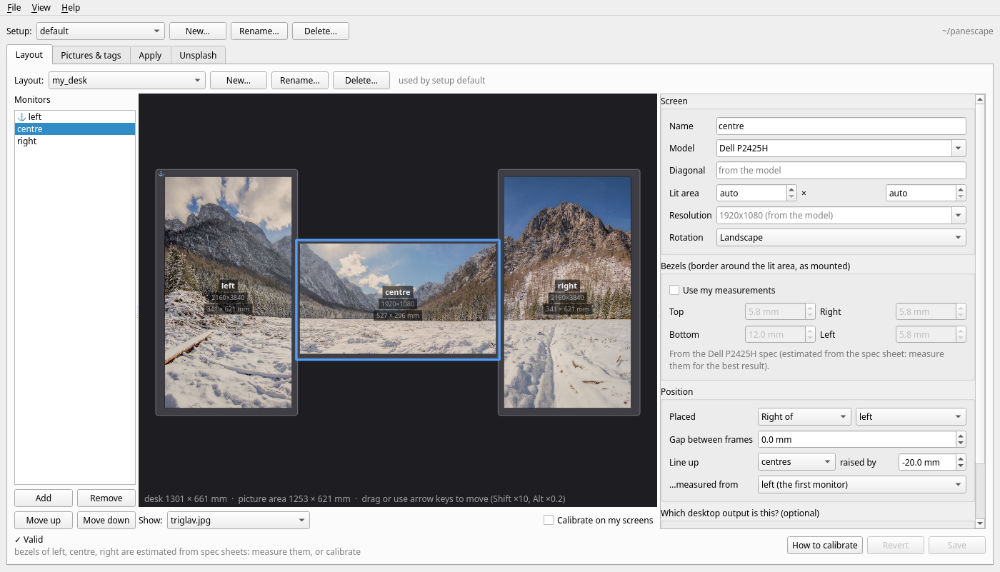
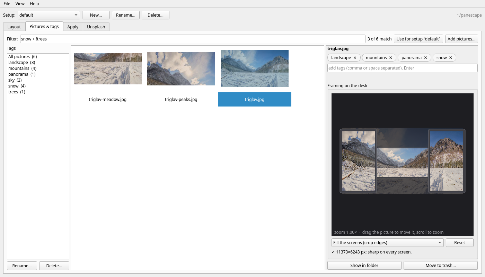
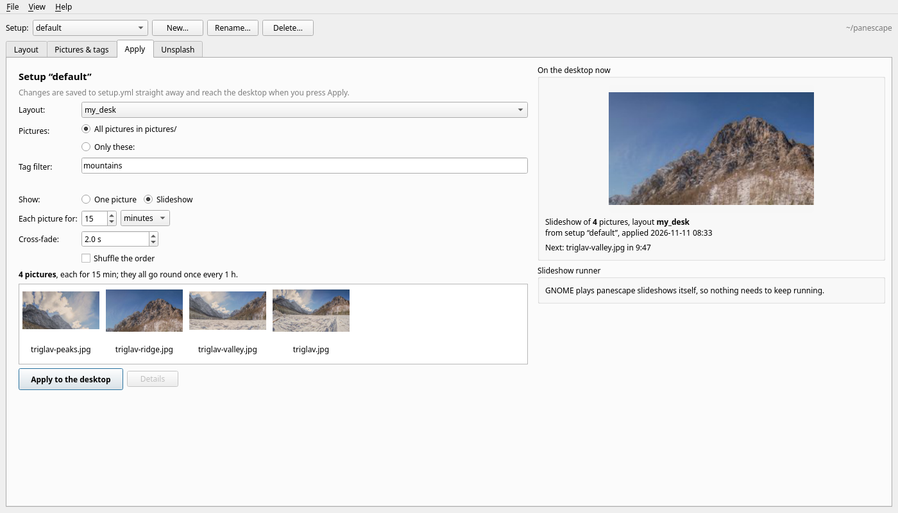

# The Window

```bash
pipx install 'panescape[gui]'
panescape-gui            # or: panescape gui
```

The window edits the same files as the [command line](cli.md), keeping your
comments, so you can switch between the two whenever you like. Click a
screenshot to see it full size.

## The Top Bar

- **Setup** (top bar): choose which [setup](setups.md) is active, or create,
  rename and delete setups.

The folder you're working in is shown on the right. In a new folder, a
**Getting started** strip under the top bar walks you through describing your
monitors, adding pictures and applying; each step gets a ✓ when it's done.
Close it with ✕, and bring it back with **Help ▸ Getting started**.

## Layout

[](images/gui-layout.png)

- **Layout:** pick the configuration the active setup uses, or make a new one
  from the monitors connected now, as a copy, or from scratch. Each monitor has
  a form for its model or size, resolution, rotation, bezels, position and gap.
  Mistakes show up as you type, not when you apply.
- **Drag monitors** on the to-scale desk, or select one and use the arrow keys
  (0.5 mm steps; Shift ×10, Alt ×0.2). This changes the `gap` and the
  `v_pos`/`h_pos` offsets.
- **Line up** and **…measured from** choose which edges and which monitor the
  offset is measured from. Changing either one keeps the monitor where it is and
  works out the new **raised by** for you. The first choice in **…measured from**
  names the monitor used when you don't pick one.
- **Show** a picture or the calibration pattern across the desk.
- **Calibrate on my screens** puts the [test pattern](calibrating.md) on your
  real monitors and redraws it as you drag or type. Your wallpaper comes back
  when you switch it off or close the window.

## Pictures & Tags

[](images/gui-pictures.png)

- **Add pictures** with the button, or drop files from your file manager onto
  the grid. They're copied into `pictures/`.
- **Tag** the selected pictures: type tags and press Enter. Click a tag's ✕ to
  remove it. With several pictures selected, a tag that only some of them have
  shows as e.g. `sea 2/5`; click it to give it to all of them.
- **Manage tags** in the sidebar, which shows how many pictures have each one.
  Click a tag to filter by it, or Ctrl+click to add it to the filter. Rename a
  tag to an existing one to merge them.
- **Filter** with the same syntax as `setup.yml` (`landscape + water +
  !mountains`). **Use for setup** saves the filter to the active setup.
- **Frame** a picture: drag it across the desk preview and scroll to zoom. The
  parts that will be cut off show faintly, and a note warns when a screen would
  show the picture enlarged (soft). The framing is saved in
  `pictures/crops.yml` and used by every setup.

If a panescape wallpaper is on the desktop, it updates a couple of seconds
after a change.

## Apply

[](images/gui-apply.png)

- **Edit the active setup:** its layout, all pictures or a chosen list
  (names or patterns like `city-*`), the tag filter, one picture or a
  slideshow, how long each picture stays, the cross-fade and shuffling. Each
  change is saved to `setup.yml` straight away, with your comments kept.
- **Check the selection:** the tab shows which pictures the setup picks and how
  long a full round of the slideshow takes.
- **Apply to the desktop** puts it on your screens. **Details** shows the log.
- **On the desktop now:** the picture showing, what comes next and when, and
  a note when the setup has changed since it was applied.
- **Slideshow runner** (sway, Hyprland, KDE): see whether it's running, start
  or stop it, and have it start when you log in. On sway and Hyprland the tab
  gives you the line to add to your config, with a Copy button, and notices
  when your config already has it. It also lets you choose the wallpaper tool
  (`setter`).

## Unsplash

The Unsplash tab searches Unsplash and suggests photos like the ones you have.
It has [its own page](unsplash.md).

## Menus and Shortcuts

| menu | what's there |
|---|---|
| **File** | **Open folder…** switches to another panescape folder, or makes a new one. **Show folder in file manager**. **Quit** |
| **View** | the four tabs |
| **Help** | Getting started, How to calibrate, these docs, Report a problem, **Show panescape in the app menu** (see [Installing](install.md#add-it-to-your-app-menu)), About |

| key | does |
|---|---|
| Ctrl+1 … Ctrl+4 | switch tabs |
| Ctrl+O | open another folder |
| Ctrl+S | save the layout |
| Ctrl+Q | quit |
| arrow keys | move the selected monitor 0.5 mm (Shift ×10, Alt ×0.2) |
